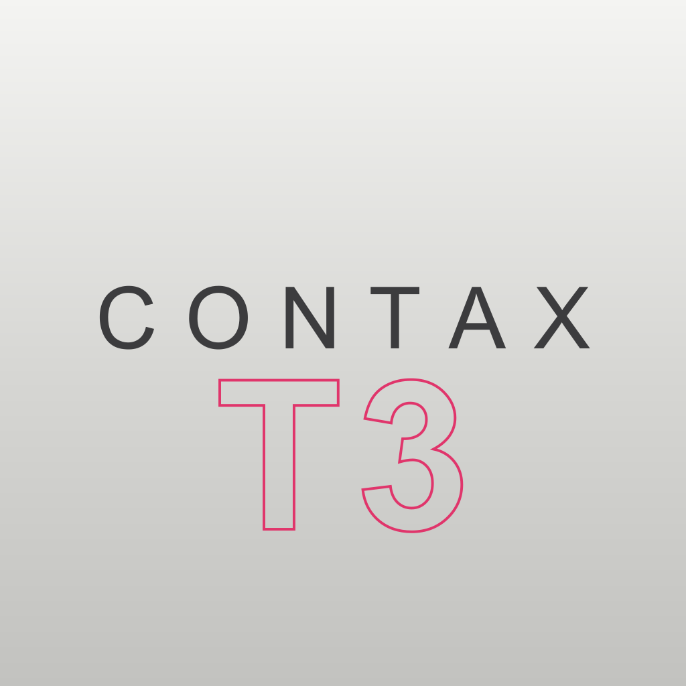

<p align="center">
  
</p>

<h1 align="center">Relic Cam</h1>

<p align="center">
  <strong>Load a roll. Press the shutter. Develop the surprise.</strong><br>
  The native iOS port of Relic Cam · CONTAX T3 interaction · a real film engine
</p>

<p align="center">
  <a href="README.md">简体中文</a> · English ·
  <a href="#how-it-works">How it works</a> · <a href="#install">Install</a> ·
  <a href="#build-from-source">Build from source</a> · <a href="#background">Background</a>
</p>

Relic Cam turns "taking a photo" back into a film ritual: **load a roll → shoot → develop in the darkroom → only then see the print**. The viewfinder never shows frames you've already taken, just like a real film camera — you trust the roll in your pocket and wait for the chemistry to reveal it. This iOS build carries over the soul of the Android Relic Cam, with an interface rebuilt around the **CONTAX T3** LCD logic.

> Current build: `1.2.5` (8), for iPhone and iPad, iOS 18+. Installed by sideloading (ad-hoc signing).

## How it works

1. **Load a roll.** Pick a stock from the film bay — Portra, Gold, Tri-X, Ektachrome and more. Each roll holds 36 exposures.
2. **Frame and shoot.** A T3-style viewfinder: 2:3 / 3:4 frames, green focus lamp, shutter speed and an LCD frame counter. Each shutter press writes a latent frame to undeveloped film — **the viewfinder shows no preview of the result**.
3. **Send the roll to the darkroom.** Shoot the whole roll or develop early. The real engine develops each frame, with progress and estimated time on screen.
4. **See the prints.** Only after development do the images appear in the darkroom — that's when you can browse, rate and save favorites to the Photos app.

The line "what you can't see is what's most beautiful" is Relic Cam's design from day one.

## Install

CI compiles an ad-hoc signed IPA on every push; sideload it with [Sideloadly](https://sideloadly.io/) and a free Apple ID.

1. Download `RelicCam-unsigned.ipa` from the `build-ipa` branch (or the Actions artifact).
2. Install Sideloadly, sign the IPA with your Apple ID and install it on your iPhone.
3. Before first launch: **Settings → Privacy & Security → Developer Mode**, enable and restart; trust this computer.
4. Open Relic Cam, load a roll and start shooting.

> Apps signed with a free Apple ID expire after 7 days and need re-sideloading. A paid developer account extends this.

## UI & interaction

- **CONTAX T3 home screen**: silver-body feel, LCD frame window, green lamp and shutter-speed indicator, detailed to match the Android Relic Cam.
- **Adaptive layouts**: scaled by the screen's short edge, from iPhone 13 mini to iPad.
- **State machine**: `shooting → developing → developed → editable`. Undeveloped film is never shown as a print anywhere.
- **Resume & diagnostics**: interrupted rolls resume from a checkpoint; development logs persist on disk for troubleshooting.

## Build from source

The iOS app uses SwiftUI with a shared C++20 / Metal film engine. CI (the `xcode-27` runner) builds automatically on pushes to `main`.

```sh
git clone https://github.com/steveJJJ/RelicCam-iOS.git
cd RelicCam-iOS

# The Xcode project is generated; icon and Info.plist come from one config
python3 ios/Silverphase/Tools/gen-project.py

# Device builds need Xcode 27 and the Metal Toolchain; see the iOS build notes
xcodebuild -downloadComponent MetalToolchain
```

Full build, signing and device-sideload steps are in the repo's iOS build docs and the preflight SOP.

## Background

Relic Cam iOS is a native port of the Android Relic Cam, developed on top of the open-source film engine [Silverphase](https://github.com/akinal5765-byte/Silverphase), wiring its physical film/print pipeline into a camera interaction of load → shoot → develop → print.

The full migration and redesign notes — engine research, Windows feasibility, the Silverphase fork plan, the soul-preserving interaction redesign, and stage reports — live in this repository's docs and issues.

### Credits & license

Relic Cam's imaging engine derives from [Silverphase](https://github.com/akinal5765-byte/Silverphase), itself an independent derivative of Hanze Qiu's [SpektraLab](https://github.com/JamesQiu2005/SpektraLab); its physical model and measured film/print stocks come from Andrea Volpato's [spektrafilm](https://github.com/andreavolpato/spektrafilm). CONTAX is a trademark of CONTAX Co., Ltd.; the wordmark here is used only to reproduce the interface style and does not grant trademark rights. See `COPYING` and `LICENSES.md` for the full license.
