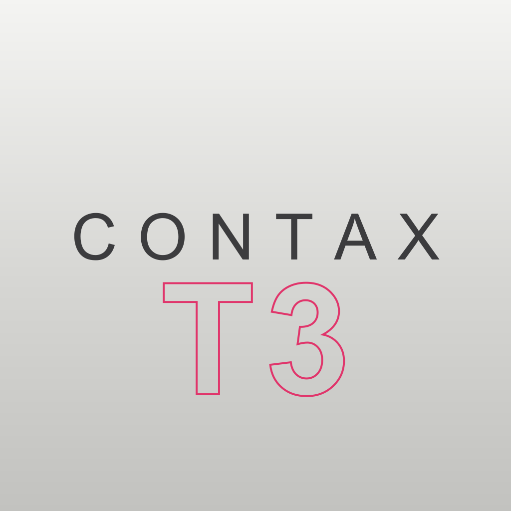

<p align="center">
  
</p>

<h1 align="center">Relic Cam</h1>

<p align="center">
  <strong>装上胶卷，按下快门，冲出惊喜。</strong><br>
  Relic Cam 的 iOS 原生移植 · 康泰时 T3 交互 · 真实胶片工艺引擎
</p>

<p align="center">
  简体中文 · <a href="README.en.md">English</a> ·
  <a href="#玩法">玩法</a> · <a href="#安装">安装</a> ·
  <a href="#从源码构建">从源码构建</a> · <a href="#项目背景">项目背景</a>
</p>

Relic Cam 把「拍一张照片」还原成一段有仪式感的胶片流程：**选胶卷 → 取景拍摄 → 送暗房冲洗 → 才看到成片**。取景窗里看不到已经拍下的画面，就像一台真正的胶片相机——你只能相信手中的卷，等冲洗出来才揭晓。iOS 版本沿用安卓版 Relic Cam 的灵魂交互，界面按 **CONTAX T3** 的 LCD 逻辑重做。

> 当前版本：`1.2.5`（构建 8），面向 iPhone／iPad，iOS 18 及以上。通过侧载安装（ad-hoc 签名）。

## 玩法

1. **装胶卷。** 从胶卷仓选择一支胶卷（Portra、Gold、Tri-X、Ektachrome 等多款），装进相机。每卷 36 张。
2. **取景拍摄。** T3 风格取景窗：2:3／3:4 画幅、绿灯对焦提示、快门速度、LCD 张数显示。快门按下后，画面存进「未冲洗底片」——**取景窗里看不到成片**。
3. **拍完整卷或随时送洗。** 进入暗房，把整卷底片交给真实引擎逐张显影。进度页显示显影张数与预估时间。
4. **冲洗后看成片。** 只有冲洗完成，成片才出现在暗房；此刻才能翻看、评分，并把喜欢的照片存入系统相册。

取景窗里那句「看不见的才是最迷人的」，是 Relic Cam 与生俱来的设计。

## 安装

iOS 版本通过 CI 云编译产出 ad-hoc 签名的 IPA，使用 [Sideloadly](https://sideloadly.io/) 配合免费 Apple ID 侧载到真机。

1. 从本仓库 `build-ipa` 分支下载 `RelicCam-unsigned.ipa`（或在 Actions 的构建产物中取）。
2. 电脑安装 Sideloadly，用你的 Apple ID 签名并安装 IPA 到 iPhone。
3. 首次打开前，在 iPhone 上进入 **设置 → 隐私与安全性 → 开发者模式**，开启并重启；信任此电脑。
4. 打开 Relic Cam，装卷开拍。

> 免费 Apple ID 签名的 App 有效期为 7 天，到期后需重新侧载。企业签名或付费开发者账号可延长。

## UI 与交互

- **CONTAX T3 主页**：银色机身质感、LCD 张数窗、绿灯与快门速度指示，细节对齐安卓版 Relic Cam。
- **多机型适配**：按屏幕短边自适应缩放，兼容 iPhone 13 mini 到 iPad。
- **状态机**：`拍摄中 → 暗房冲洗 → 已冲洗 → 可编辑`。未冲洗的底片不会在任何界面显示成片。
- **续冲与诊断**：中断的胶卷可从断点续冲；显影日志落盘，便于排查内存或引擎问题。

## 从源码构建

iOS 工程使用 SwiftUI 界面 + 共享的 C++20／Metal 胶片引擎。CI（`xcode-27` runner）在推送到 `main` 时自动编译。

```sh
git clone https://github.com/steveJJJ/RelicCam-iOS.git
cd RelicCam-iOS

# 工程由脚本生成，图标与 Info.plist 均来自同一份配置
python3 ios/Silverphase/Tools/gen-project.py

# 真机编译需要 Xcode 27 与 Metal Toolchain；详见 iOS 构建说明
xcodebuild -downloadComponent MetalToolchain
```

完整构建、签名与真机侧载步骤见仓库内的 iOS 构建文档与[装工具与真机预检 SOP](https://github.com/steveJJJ/RelicCam-iOS)。

## 项目背景

Relic Cam iOS 是安卓版 Relic Cam 的原生移植，基于开源胶片引擎 [Silverphase](https://github.com/akinal5765-byte/Silverphase) 二次开发，把它的物理胶片/相纸模拟管线接进「装卷—拍摄—冲洗—成片」的相机交互。

迁移与改造的完整方案记录在本仓库的文档与 issue 中：引擎调研、Windows 单机可行性、Fork Silverphase 方案、灵魂交互改造方案、各阶段开工报告等。

### 来源与署名

Relic Cam 的成像引擎源自 Hanze Qiu 的 [SpektraLab](https://github.com/JamesQiu2005/SpektraLab) 独立衍生项目 [Silverphase](https://github.com/akinal5765-byte/Silverphase)；其物理模型及原始实测胶片／相纸配置来自 Andrea Volpato 的 [spektrafilm](https://github.com/andreavolpato/spektrafilm)。CONTAX 是株式会社康泰时的商标；此处字标仅用于界面风格还原，不构成商标授权。完整许可见仓库 `COPYING` 与 `LICENSES.md`。
